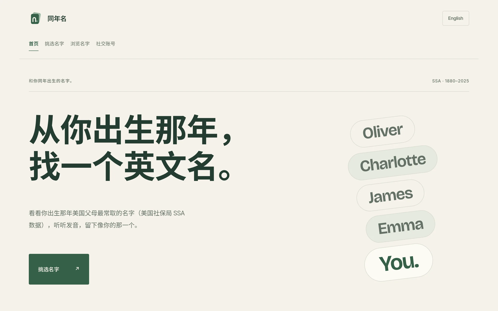
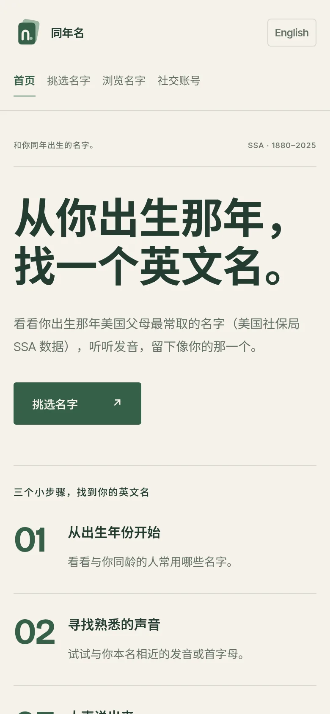
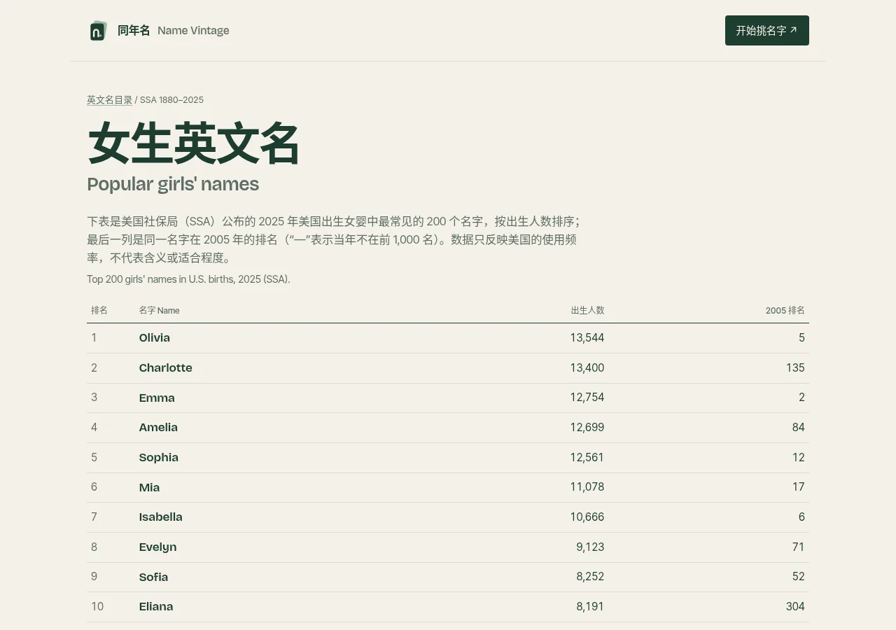
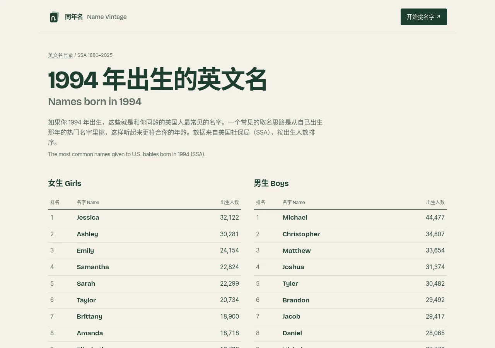

> Looking for names popular the year you were born? Try [**Name Vintage / 同年名**](https://lexcao.io/English-name-picker/) — U.S. SSA data for 1880–2025, with pronunciation and a shortlist. Or browse [girls' names](https://lexcao.io/English-name-picker/names/girls/), [boys' names](https://lexcao.io/English-name-picker/names/boys/), a [year page](https://lexcao.io/English-name-picker/names/year/2000/), or an [A–Z letter page](https://lexcao.io/English-name-picker/names/letter/a/).

## Quick steps: how to choose an English name for yourself

If you are asking, “How do I choose an English name for myself?”, start with a name you feel comfortable using. You can also keep your Chinese name in pinyin; an English name is optional.

1. **Start with your own name.** Try a familiar sound or the first letter of your pinyin name.
2. **Make a shortlist.** Pick a few established names; birth-year name lists can provide ideas.
3. **Say each name aloud.** Practise introducing yourself and saying the name with your surname.
4. **Check the spelling and context.** Listen to the pronunciation and consider whether the name suits your everyday setting.
5. **Try it before settling.** Use it in a few introductions, then choose the one you like answering to.

## Why I made Name Vintage

My Chinese name in pinyin is Lixin Cao. When I was looking for a way to choose an English name for myself, I found [*How to choose an English name*](http://www.pgbovine.net/choosing-english-name.htm). Its method — pick from the **most popular names for your birth year**, preferably ones that sound a little like your own — inspired a small tool. I later renamed it **Name Vintage / 同年名**: look at the English names that were common the year you were born.

You can try it here: [*Name Vintage*](https://lexcao.io/English-name-picker/).

On a phone it looks like this:

Below I explain the original advice, how the tool works, and how I eventually chose Lex.

## Advice from the original post

The following is the original author’s advice, including some strongly worded opinions. Treat it as a starting point, not a requirement: naming customs vary across English-speaking communities.

**Do not try to be creative in picking an English name.**

Avoid:

> * Do not try to pick a fun or cute-sounding name from a movie, television, or video game character
> * Do not pick a name that you think sounds cool or trendy, because Americans will think it sounds stupid
> * Do not pick a name because your friends think it sounds cute, because your friends are not the Americans you have to interact with in the future
> * Do not translate some positive-sounding word in your language into English and make that into your name

Do:

> 1. Choose a name from the **100 most popular names for your birth year**
> 2. If possible, choose a name that sounds somewhat similar to your real name
> 3. Do not choose a variation as your official name
> 4. Do not worry about what a name means

## How Name Vintage works

> Choose a name from the 100 most popular names for your birth year

I downloaded the [*SSA baby names data*](https://www.ssa.gov/oact/babynames/limits.html) which the post suggested (1880–2025), formatted it as JSON, and put it on [*GitHub*](https://github.com/lexcao/English-name-dataset). You can use it for free or make another English name application.

Name Vintage lets you swipe through a birth year, listen to pronunciations, and keep a shortlist. The same SSA data also powers static list pages that are easy to browse and search, for example:

* [Girls' English names](https://lexcao.io/English-name-picker/names/girls/) (top 200 U.S. births in 2025, with 2005 rank)
* [Boys' English names](https://lexcao.io/English-name-picker/names/boys/)
* By year: [1990](https://lexcao.io/English-name-picker/names/year/1990/), [1994](https://lexcao.io/English-name-picker/names/year/1994/), [2000](https://lexcao.io/English-name-picker/names/year/2000/), [2010](https://lexcao.io/English-name-picker/names/year/2010/) (top 100 per sex)
* By letter: [A](https://lexcao.io/English-name-picker/names/letter/a/), [L](https://lexcao.io/English-name-picker/names/letter/l/), [full index](https://lexcao.io/English-name-picker/names/)

Those pages show SSA birth counts and ranks only — no invented name meanings.

## How I chose my English name

1. I took inspiration from my Chinese name, Lixin Cao, and wanted an English name beginning with `L`.
2. I looked through names from my birth year, 1994, and shortlisted ones I liked.
   1. Levi
   2. Alex
   3. Lucas
   4. Liam
3. I checked names combined with my surname as social media usernames, such as LeviCao. My notes at the time were:
   1. Levi (biblical)
   2. Alex (already taken)
   3. Lucas (felt too popular to me)
   4. Liam (felt too popular to me)
4. I looked up name meanings on [*NameBerry*](https://nameberry.com/) and [*BehindTheName*](https://behindthename.com) to find variants of the name.
5. I liked ***Alex*** most and finally picked ***Lex*** as my English name.

To try the same approach, open [names born in 1994](https://lexcao.io/English-name-picker/names/year/1994/) or pick your own year in [Name Vintage](https://lexcao.io/English-name-picker/).

## Common mistakes for Chinese speakers

- **Translating a word directly into a name.** An object or positive word is not automatically a familiar given name. Some word names, such as Rose, are established names; check actual usage before choosing an unfamiliar word.
- **Skipping pronunciation practice.** English r, l, and th sounds can take practice for some Chinese speakers, depending on their first language or dialect. Say the whole name aloud and choose a pronunciation you are comfortable using.
- **Choosing only for a trend.** A name may sound old-fashioned or fashionable to different generations and in different countries. Birth-year lists offer context, but popularity is not a rule.
- **Overlooking spelling variants.** Names such as Sara and Sarah have established spellings. Pick one spelling and use it consistently; an unusual spelling may need more explanation.

## Common names by pinyin initial

Matching the first letter is optional: English and pinyin letters do not always represent the same sound. These are starting points, without claims about name meanings. For more letter browsing, see the [Name Vintage letter pages](https://lexcao.io/English-name-picker/names/letter/a/).

| Pinyin initial | Names to try |
| --- | --- |
| A | Alex, Anna |
| C | Charles, Chloe |
| J | James, Julia |
| L | Leo, Lily |
| M | Mark, Mary |
| S | Sam, Sophie |
| W | William, Wendy |
| Z | Zoe, Zach |

## FAQ

### Should I keep my pinyin name?

Yes, if you prefer it. You can introduce yourself with your pinyin name and explain its pronunciation. An English name is a personal choice, not a requirement for speaking English.

### Does the meaning of an English name matter?

It can matter to you, but it does not have to drive your choice. Pronunciation, spelling, and how you feel using the name are useful considerations. If you research a meaning, check reliable references rather than assuming a flattering description is accurate. Name Vintage list pages show SSA usage frequency only, not meanings.

### Can I change my English name later?

You can try a different name for everyday introductions and let people know what you prefer. Changing a legal name is a separate process; keep official records consistent with the documents required for that situation.

### Should I choose a male, female, or gender-neutral name?

Choose what fits you. Some names are commonly associated with men or women, while names such as Alex and Sam are used across genders. Usage can vary by country and community. You can also browse [girls' names](https://lexcao.io/English-name-picker/names/girls/) and [boys' names](https://lexcao.io/English-name-picker/names/boys/) separately.

## References

* [*Name Vintage / 同年名*](https://lexcao.io/English-name-picker/)
* [*Girls' names*](https://lexcao.io/English-name-picker/names/girls/) · [*Boys' names*](https://lexcao.io/English-name-picker/names/boys/) · [*Name index*](https://lexcao.io/English-name-picker/names/)
* [*Source code*](https://github.com/lexcao/English-name-picker)
* [*English-name-dataset*](https://github.com/lexcao/English-name-dataset)
* [*How to choose an English name*](http://www.pgbovine.net/choosing-english-name.htm)
* [*SSA baby names*](https://www.ssa.gov/oact/babynames/)
* [*SSA baby names data*](https://www.ssa.gov/oact/babynames/limits.html)
