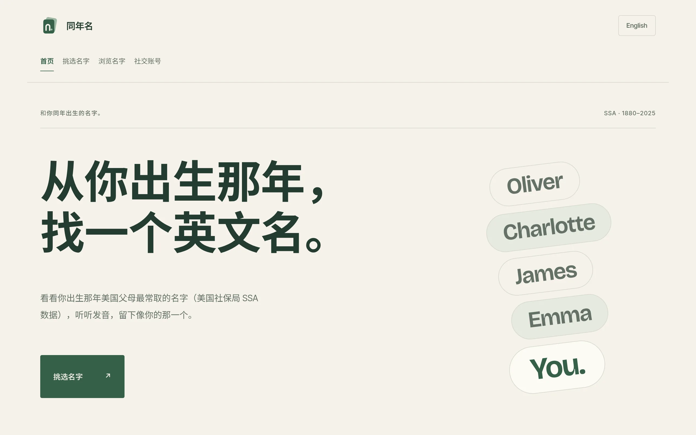
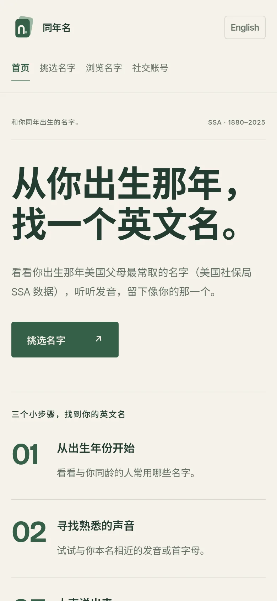
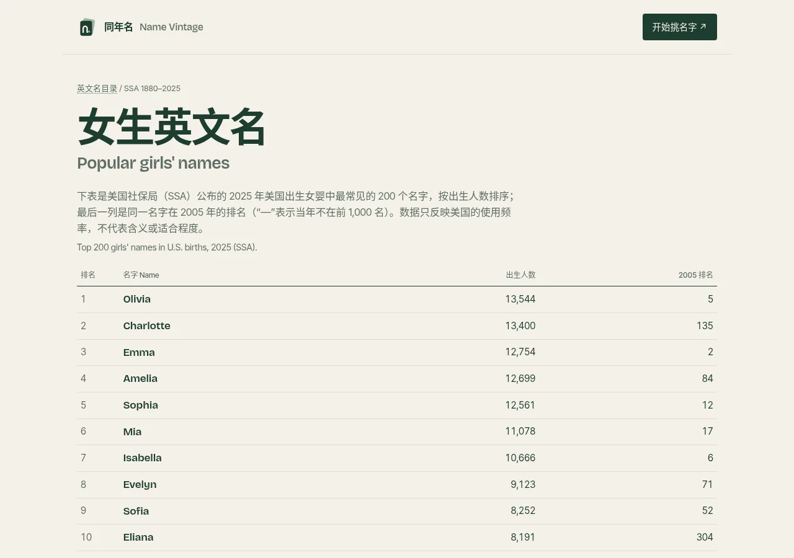
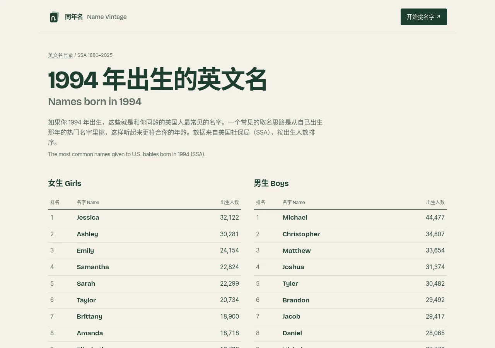

> 想直接看看你出生那年最常见的英文名？打开 [**同年名 / Name Vintage**](https://lexcao.io/English-name-picker/)：美国社保局 SSA 1880–2025 数据，可听发音、做候选名单；也可先浏览 [女生英文名](https://lexcao.io/English-name-picker/names/girls/)、[男生英文名](https://lexcao.io/English-name-picker/names/boys/) 或 [按年份](https://lexcao.io/English-name-picker/names/year/2000/)、[按字母](https://lexcao.io/English-name-picker/names/letter/a/) 的榜单页。

## 快速了解：给自己起英文名的 5 个步骤

怎么起英文名，才能让自己用得自然、介绍起来方便？可以先从下面 5 个步骤开始。英文名并非必需，如果你喜欢，也可以一直使用中文名的拼音。

1. **从自己的名字找灵感。** 试试中文名拼音的首字母，或与中文名相近的发音。
2. **列出几个候选名字。** 从常见名字中挑选，也可以参考自己出生年份的名字榜单。
3. **把名字读出来。** 练习自我介绍，并把英文名和姓氏连起来读。
4. **确认拼写和使用场景。** 听听名字的发音，想想是否适合日常学习、工作和交流。
5. **先试用，再确定。** 在几次自我介绍中试用，选择自己喜欢、听到时也愿意回应的名字。

## 我为什么做了「同年名」

我的中文名拼音是 Lixin Cao。给自己起英文名时，我发现了这篇文章：[*如何选择一个英文名字*](http://www.pgbovine.net/choosing-english-name.htm)。它提供了一种挑选思路：从**出生那年最流行的名字**里选，尽量找读音相近的。我据此做了一个小工具，后来改名为 **同年名 / Name Vintage**——按你出生那年，看看当时最常见的英文名。

你可以在 [*同年名*](https://lexcao.io/English-name-picker/) 试用：

手机上同样可以直接挑：

下面介绍原文的建议、工具怎么用，以及我最后选择 Lex 的过程。

## 原文给出的建议

以下是原文建议的中文翻译。其中一些说法带有作者鲜明的个人判断，可以作为参考；不同英语国家和社群的取名习惯也有差异。

**不要刻意追求英文名的创意。**

避免：

* 不要从电影、电视或游戏角色中挑选一个只因有趣或发音可爱而喜欢的名字
* 不要只因为自己觉得一个名字很酷或新潮就选择它；原作者认为，美国人可能会觉得这样的名字很傻
* 不要只因为朋友觉得一个名字可爱就选择它，因为朋友并不代表你将来要交流的美国人
* 不要把母语中寓意积极的词直接翻译成英语，再把它当作名字

推荐：

1. 从**你出生那年最流行的 100 个名字**中选择一个
2. 如果可以，选择一个读音与你本名相近的名字
3. 不要把名字的变体用作正式名字
4. 不必担心名字的含义

## 同年名是怎么做的

> 从**你出生那年最流行的 100 个名字**中选择一个

我根据文章的建议从 [*美国社保局出生婴儿名字数据*](https://www.ssa.gov/oact/babynames/limits.html) 下载了原始数据（SSA，覆盖 1880–2025），整理成 JSON 放在 [*GitHub*](https://github.com/lexcao/English-name-dataset) 上。使用前请先阅读数据的 [*说明*](https://github.com/lexcao/English-name-dataset/blob/master/raw/NationalReadMe.pdf)。欢迎免费使用这些数据，也欢迎用它们制作自己的英文名应用。

同年名本身可以按年份刷卡挑选、听发音、留下候选；另外还生成了一批基于同一套 SSA 数据的静态榜单页，方便搜索和浏览，例如：

* [女生英文名](https://lexcao.io/English-name-picker/names/girls/)（2025 年美国出生人数前 200，并对照 2005 排名）
* [男生英文名](https://lexcao.io/English-name-picker/names/boys/)
* 按年份：[1990](https://lexcao.io/English-name-picker/names/year/1990/)、[1994](https://lexcao.io/English-name-picker/names/year/1994/)、[2000](https://lexcao.io/English-name-picker/names/year/2000/)、[2010](https://lexcao.io/English-name-picker/names/year/2010/)（每年男女各前 100）
* 按字母：[A](https://lexcao.io/English-name-picker/names/letter/a/)、[L](https://lexcao.io/English-name-picker/names/letter/l/)、[完整目录](https://lexcao.io/English-name-picker/names/)

榜单页只展示 SSA 的出生人数与排名，不编造名字含义。

## 我是怎么选出 Lex 的

1. 从我的中文名中找灵感，Lixin Cao，我想要一个以 `L` 开头的英文名。
2. 找到我出生年的英文名字，选出一些我喜欢的。
   1. Levi
   2. Alex
   3. Lucas
   4. Liam
3. 带上我的姓氏，比如 LeviCao，去社交网站看一下有没有被占用。
   1. Levi （圣经相关的）
   2. Alex （已经被人占用）
   3. Lucas （当时我觉得太流行）
   4. Liam （当时我觉得太流行）
4. 在 [*nameberry*](https://nameberry.com) 和 [*behindthename*](https://behindthename.com) 搜索名字的含义和一些变体。
5. 我最喜欢 ***Alex***，然后我最后选择了 ***Lex*** 作为我的英文名字。

想按同样思路试一下的话，可以直接打开 [1994 年出生的英文名](https://lexcao.io/English-name-picker/names/year/1994/)，或在 [同年名](https://lexcao.io/English-name-picker/) 里选自己的出生年。

## 起英文名时常见的误区

- **把单词直接当作名字。** 物品名称或寓意积极的词，不一定是常见人名。Rose 这样的单词也确实用作名字；关键是确认实际用法，而不是只看中文翻译。
- **忽略发音是否顺口。** 对部分中文使用者来说，英语中的 r、l、th 等音需要练习，具体困难也与母语或方言有关。把名字和姓氏连起来读，看看自己是否愿意经常使用这个发音。
- **只追求复古或潮流。** 同一个名字在不同国家、不同年龄群体中，给人的感觉可能不同。出生年份榜单可以帮助了解背景，但不必把流行程度当作硬性标准。
- **忽略拼写差异。** Sara 和 Sarah 都是已有的名字拼写。选定一种后尽量保持一致；不常见的拼写可能需要反复向别人解释。

## 按中文名拼音首字母找灵感

首字母相同并不代表发音相同，下面只是常见英文名示例，不涉及名字含义，也不要求你一定按首字母选择。更多按字母浏览可看 [同年名字母页](https://lexcao.io/English-name-picker/names/letter/a/)。

| 拼音首字母 | 英文名示例 |
| --- | --- |
| A | Alex、Anna |
| C | Charles、Chloe |
| J | James、Julia |
| L | Leo、Lily |
| M | Mark、Mary |
| S | Sam、Sophie |
| W | William、Wendy |
| Z | Zoe、Zach |

## 关于起英文名的常见问题

### 可以一直使用中文名的拼音吗？

可以。你可以用中文名拼音自我介绍，并告诉对方怎么读。是否使用英文名是个人选择，使用英语交流并不要求你另起一个名字。

### 英文名的含义重要吗？

如果你在意，可以把含义作为参考，但不必让它决定一切。发音、拼写和使用时的感受也很重要。查询含义时，应核对可靠资料，不要仅凭一句好听的中文解释就下结论。同年名的榜单页只提供 SSA 使用频率，不标注含义。

### 选好英文名以后还能改吗？

日常交流中可以尝试换一个名字，并告诉身边的人你希望如何被称呼。法律姓名的变更是另一回事；办理正式事务时，应按要求使用与证件一致的信息。

### 应该选男性、女性还是中性英文名？

按自己的偏好和身份选择即可。有些名字通常用于男性或女性，Alex、Sam 等名字则可用于不同性别。具体用法也可能因国家和社群而异。也可以分别浏览 [女生英文名](https://lexcao.io/English-name-picker/names/girls/) 和 [男生英文名](https://lexcao.io/English-name-picker/names/boys/)。

## 参考链接

* [*同年名 / Name Vintage*](https://lexcao.io/English-name-picker/)
* [*女生英文名*](https://lexcao.io/English-name-picker/names/girls/) · [*男生英文名*](https://lexcao.io/English-name-picker/names/boys/) · [*名字目录*](https://lexcao.io/English-name-picker/names/)
* [*同年名 源码*](https://github.com/lexcao/English-name-picker)
* [*美国社保局英文名数据 GitHub*](https://github.com/lexcao/English-name-dataset)
* [*如何选择一个英文名*](http://www.pgbovine.net/choosing-english-name.htm)
* [*美国社保局出生婴儿名字*](https://www.ssa.gov/oact/babynames/)
* [*美国社保局出生婴儿名字数据*](https://www.ssa.gov/oact/babynames/limits.html)
